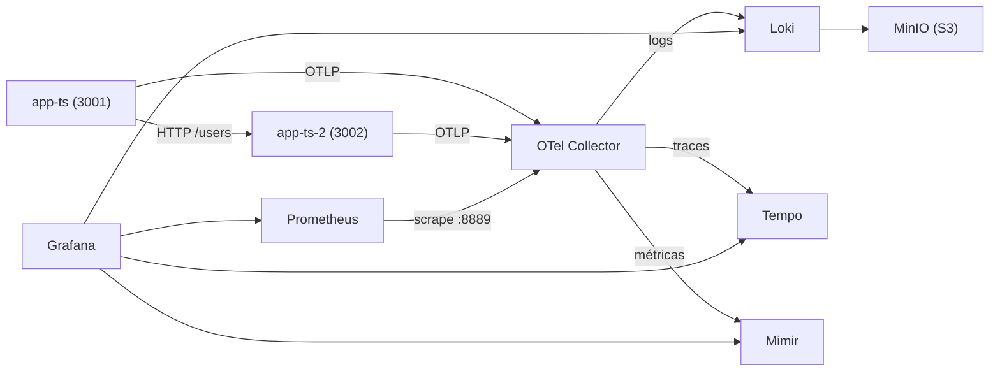

# Curso DevOps — Rocketseat

Repositório de estudos e projetos práticos desenvolvidos durante o curso de
DevOps da Rocketseat. O conteúdo percorre a jornada completa de um ambiente
moderno: infraestrutura como código com Terraform em três provedores de nuvem,
Kubernetes com cluster local criado pelo Kind, deploy de uma API NestJS com
autoscaling, observabilidade com a stack Grafana + OpenTelemetry e service mesh
com Istio.

> [!WARNING]
> Este é um projeto educacional. Antes de provisionar recursos, revise nomes,
> regiões, credenciais e possíveis custos na sua conta de nuvem.

## Sumário

- [Conteúdos praticados](#conteúdos-praticados)
- [Estrutura do repositório](#estrutura-do-repositório)
- [Pré-requisitos](#pré-requisitos)
- [1. Infraestrutura como código (Terraform)](#1-infraestrutura-como-código-terraform)
- [2. Primeiro cluster Kubernetes](#2-primeiro-cluster-kubernetes)
- [3. Deploy de aplicação no Kubernetes](#3-deploy-de-aplicação-no-kubernetes)
- [4. Observabilidade](#4-observabilidade)
- [5. Service Mesh com Istio](#5-service-mesh-com-istio)
- [Boas práticas de segurança](#boas-práticas-de-segurança)
- [Status](#status)

## Conteúdos praticados

| Módulo | Tecnologias | Conceitos |
| --- | --- | --- |
| Infraestrutura como código | Terraform, AWS, Azure, GCP | módulos, variáveis, outputs, estado remoto |
| Primeiro cluster | Kind, kubectl | Pods, ReplicaSets, Deployments, Services |
| Deploy de aplicação | NestJS, Docker, Kubernetes | ConfigMap, Secret, probes, PV/PVC, HPA, metrics-server |
| Observabilidade | OpenTelemetry, Grafana, Loki, Tempo, Mimir, Prometheus, MinIO | logs, métricas, traces, golden signals |
| Service Mesh | Istio, Kiali, Jaeger, Prometheus | VirtualService, DestinationRule, teste A/B, canary, fault injection, circuit breaker |

## Estrutura do repositório

```text
.
├── primeiro-projeto-iac/          # AWS: S3, CloudFront e backend remoto
│   ├── modules/
│   │   ├── cloudfront/
│   │   └── s3/
│   ├── main.tf
│   ├── outputs.tf
│   ├── providers.tf
│   └── variables.tf
├── primeiro-projeto-iac-azure/    # Azure: Resource Group e Virtual Network
├── primeiro-projeto-iac-gcp/      # GCP: Service Account e Compute Engine
├── primeiro-cluster/              # Kubernetes: cluster Kind e workloads Nginx
│   ├── kind.yaml
│   ├── pod.yaml
│   ├── replicaset.yaml
│   ├── deployment.yml
│   └── service.yml
├── projeto-kubernets/             # API NestJS publicada no Kubernetes
│   └── app-ts/
│       ├── src/                   # endpoints, /healthz e /readyz
│       ├── k8s/                   # Deployment, Service, ConfigMap, Secret, PV, PVC, HPA
│       └── Dockerfile             # build multi-stage
├── observability/                 # Stack de observabilidade com Docker Compose
│   ├── app-ts/                    # Aplicação 1 (porta 3001) — chama a Aplicação 2
│   ├── app-ts-2/                  # Aplicação 2 (porta 3002) — lista usuários
│   ├── config/                    # Grafana, Loki, Mimir, OTel Collector, Prometheus, Tempo
│   ├── docker-compose.yaml
│   └── golden-signals.md
└── service-mesh/                  # Istio em cluster Kind
    ├── infra/                     # cluster Kind, Kiali e Prometheus
    └── app-ts/
        ├── src/
        └── k8s/                   # Deployments V1/V2, Service, VirtualService, DestinationRule, Jaeger
```

## Pré-requisitos

Ferramentas utilizadas ao longo do curso:

- [Git](https://git-scm.com/);
- [Terraform](https://developer.hashicorp.com/terraform/install);
- [Docker](https://docs.docker.com/get-docker/) e Docker Compose;
- [kubectl](https://kubernetes.io/docs/tasks/tools/);
- [Kind](https://kind.sigs.k8s.io/docs/user/quick-start/#installation);
- [Node.js](https://nodejs.org/) 20+ e [Yarn](https://yarnpkg.com/);
- [istioctl](https://istio.io/latest/docs/setup/getting-started/#download) (módulo de service mesh).

Para os projetos Terraform, também é necessário ter uma conta e a CLI
autenticada no provedor utilizado:

- [AWS CLI](https://docs.aws.amazon.com/cli/latest/userguide/getting-started-install.html);
- [Azure CLI](https://learn.microsoft.com/cli/azure/install-azure-cli);
- [Google Cloud CLI](https://cloud.google.com/sdk/docs/install).

Clone o repositório:

```bash
git clone https://github.com/MuriloNSantos17/Curso-DevOps-Rocketseat.git
cd Curso-DevOps-Rocketseat
```

## 1. Infraestrutura como código (Terraform)

O fluxo básico é o mesmo em cada diretório:

```bash
terraform init
terraform fmt -check
terraform validate
terraform plan
terraform apply
```

Ao terminar os testes, remova os recursos para evitar cobranças:

```bash
terraform destroy
```

### AWS

O projeto em `primeiro-projeto-iac/` utiliza módulos locais para criar:

- um bucket S3 com configuração de site estático;
- uma distribuição CloudFront;
- um bucket S3 versionado para armazenar o estado remoto.

Antes de executar, revise `providers.tf` e ajuste o perfil AWS, a região e o
nome do bucket de estado. O backend remoto precisa existir antes do primeiro
`terraform init`; ele não pode ser criado pelo mesmo estado que pretende
armazenar.

```bash
cd primeiro-projeto-iac
aws configure --profile SEU_PERFIL
terraform init
terraform plan
terraform apply
terraform output
```

Os nomes de buckets S3 são globais. Portanto, substitua os nomes presentes no
projeto por valores únicos antes de aplicar a infraestrutura.

### Azure

O projeto em `primeiro-projeto-iac-azure/` cria um Resource Group na região
`brazilsouth` e uma Virtual Network com o bloco `10.0.0.0/16`.

```bash
cd primeiro-projeto-iac-azure
az login
terraform init
terraform plan
terraform apply
```

Revise a assinatura ativa com `az account show` antes de confirmar o
provisionamento.

### Google Cloud

O projeto em `primeiro-projeto-iac-gcp/` cria uma Service Account e uma
instância Compute Engine `e2-micro` na zona `us-central1-a`.

```bash
cd primeiro-projeto-iac-gcp
gcloud auth application-default login
gcloud config set project SEU_PROJECT_ID
terraform init
terraform plan
terraform apply
```

O provider atual referencia um arquivo JSON e um projeto específicos. Ajuste
esses valores em `providers.tf` para a sua conta. Nunca envie chaves de contas
de serviço para o Git.

## 2. Primeiro cluster Kubernetes

O diretório `primeiro-cluster/` contém a configuração de um cluster local com
um nó de control plane e um worker, além de diferentes formas de executar o
Nginx.

Crie o cluster:

```bash
cd primeiro-cluster
kind create cluster --name rocketseat --config kind.yaml
kubectl cluster-info --context kind-rocketseat
kubectl get nodes
```

Para o fluxo recomendado, use o Deployment e o Service:

```bash
kubectl apply -f deployment.yml
kubectl apply -f service.yml
kubectl get deployments,pods,services
kubectl port-forward service/nginx-svc 8080:80
```

Com o port-forward em execução, acesse `http://localhost:8080`.

Os arquivos `pod.yaml` e `replicaset.yaml` permitem estudar os recursos de
forma isolada. Evite aplicar o ReplicaSet junto com o Deployment durante o
mesmo exercício, pois ambos gerenciam Pods com o rótulo `app: nginx`.

## 3. Deploy de aplicação no Kubernetes

O diretório `projeto-kubernets/app-ts/` contém uma API NestJS empacotada com um
Dockerfile multi-stage (`node:24-alpine`, execução com usuário não root) e os
manifestos para publicá-la no cluster.

Endpoints da aplicação (porta `3000`):

| Rota | Descrição |
| --- | --- |
| `GET /` | rota principal |
| `GET /example-k8s` | lê variáveis vindas do ConfigMap/Secret |
| `GET /healthz` | usado pelas probes de startup e liveness |
| `GET /readyz` | usado pela readiness probe |

Recursos em `k8s/`:

- **Deployment** com 6 réplicas, estratégia `RollingUpdate`, probes,
  requests/limits e volume montado em `/usr/src/app/uploads`;
- **Service** `ClusterIP` (`app-ts-svc`, porta 80 → 3000);
- **ConfigMap** (`APP`) e **Secret** (`API_KEY`) injetados via `envFrom`;
- **PersistentVolume** / **PersistentVolumeClaim** (`hostPath`) e um exemplo de
  **StorageClass**;
- **HorizontalPodAutoscaler** (`autoscaling/v2`) de 6 a 10 réplicas com base em
  CPU (75%) e memória (80%), com políticas de scale up/down;
- **metrics-server**, necessário para o HPA coletar métricas.

Executando localmente com Kind (reaproveitando o cluster do módulo anterior):

```bash
cd projeto-kubernets/app-ts

# build da imagem e envio para os nós do Kind
docker build -t murilonsantos/app-ts:v12 .
kind load docker-image murilonsantos/app-ts:v12 --name rocketseat

# metrics-server (namespace kube-system)
kubectl apply -f k8s/metrics-server.yaml

# aplicação
kubectl create namespace primeira-aplicacao
kubectl apply -n primeira-aplicacao -f k8s/configmap.yaml -f k8s/secret.yaml \
  -f k8s/pv.yaml -f k8s/pvc.yaml -f k8s/deployment.yaml -f k8s/service.yaml -f k8s/hpa.yaml

kubectl get pods,svc,hpa -n primeira-aplicacao
kubectl port-forward -n primeira-aplicacao service/app-ts-svc 3000:80
```

Para rodar a API fora do cluster:

```bash
yarn install
yarn start:dev
```

> [!NOTE]
> O arquivo `hpa-v1.yaml` mantém, comentada, a versão `autoscaling/v1` do HPA
> apenas para comparação.

## 4. Observabilidade

O diretório `observability/` sobe, via Docker Compose, uma stack completa para
coletar **logs, métricas e traces** de duas aplicações NestJS instrumentadas
com OpenTelemetry.



Serviços do `docker-compose.yaml`:

| Serviço | Função | Porta local |
| --- | --- | --- |
| Grafana | visualização (datasources provisionados automaticamente) | `3005` |
| OTel Collector | recebe OTLP e distribui para os backends | `4317` (gRPC), `4318` (HTTP) |
| Loki | armazenamento de logs | `3100` |
| MinIO | object storage S3 usado pelo Loki | `9000` (API), `9001` (console) |
| Tempo | armazenamento de traces | interno (`3200`) |
| Mimir | armazenamento de métricas de longo prazo | `9009` |
| Prometheus | coleta métricas expostas pelo Collector | `9090` |

O Grafana já vem com os datasources Loki, Tempo, Mimir e Prometheus
configurados, incluindo a correlação **trace ↔ log** pelo `trace_id`.

As aplicações utilizam:

- `@opentelemetry/sdk-node` com auto-instrumentação para traces;
- exportação de métricas OTLP a cada 10 segundos;
- logs estruturados com `pino`.

A **Aplicação 1** (`app-ts`, porta `3001`) expõe `GET /users`, que consulta a
**Aplicação 2** (`app-ts-2`, porta `3002`), gerando um trace distribuído entre
os dois serviços. Ela também expõe `GET /health` e `GET /metric-test`.

Subindo o ambiente:

```bash
cd observability
docker compose up -d

# em um terminal
cd app-ts-2 && yarn install && yarn start:dev

# em outro terminal
cd app-ts && yarn install && yarn start:dev

# gerando tráfego
curl http://localhost:3001/users
```

Acesse o Grafana em `http://localhost:3005` (acesso anônimo como Admin,
apenas para ambiente local) e explore os dados em **Explore**.

O arquivo `golden-signals.md` resume os quatro sinais de ouro do
monitoramento: **latência, tráfego, erros e saturação**.

Para encerrar:

```bash
docker compose down
```

## 5. Service Mesh com Istio

O diretório `service-mesh/` demonstra o gerenciamento de tráfego entre versões
de uma aplicação utilizando Istio em um cluster Kind com um control plane e
dois workers.

Recursos utilizados:

- **Deployments V1 e V2** da mesma aplicação (`version: V1` / `version: V2`)
  atrás de um único Service (`app-service-mesh-svc`);
- **DestinationRule** com subsets `V1`/`V2`, *outlier detection* (circuit
  breaker) e balanceamento por *consistent hash*;
- **VirtualService** com roteamento para a V2 quando a query string contém
  `testeab=true` (teste A/B) e exemplos comentados de *canary* por peso,
  *rewrite* de URI, *fault injection* (delay/abort), *retries* e *timeout*;
- **Kiali**, **Prometheus** e **Jaeger** no namespace `istio-system` para
  visualizar a malha, métricas e traces.

Executando:

```bash
cd service-mesh

# cluster e Istio
kind create cluster --config infra/kind.yaml
istioctl install --set profile=demo -y

# addons
kubectl apply -f infra/prometheus.yaml
kubectl apply -f infra/kiali.yaml
kubectl apply -f app-ts/k8s/jaeger.yaml

# namespace da aplicação com injeção de sidecar
kubectl create namespace app
kubectl label namespace app istio-injection=enabled

# imagens (ajuste as tags conforme o seu build)
docker build -t murilonsantos/app-service-mesh:v2 app-ts
kind load docker-image murilonsantos/app-service-mesh:v2 --name cluster-service-mesh

# aplicação e regras de tráfego
kubectl apply -n app -f app-ts/k8s/deployment.yaml -f app-ts/k8s/deployment-v2.yaml \
  -f app-ts/k8s/service.yaml -f app-ts/k8s/destination-rule.yaml \
  -f app-ts/k8s/virtual-service.yaml

kubectl get pods -n app
istioctl dashboard kiali
```

Teste o roteamento de dentro do cluster:

```bash
kubectl run curl -n app --rm -it --image=curlimages/curl -- sh
curl http://app-service-mesh-svc/               # V1
curl "http://app-service-mesh-svc/?testeab=true" # V2
```

> [!NOTE]
> O `deployment-v2.yaml` utiliza a imagem `murilonsantos/app-service-mesh:v3`.
> Gere e carregue essa tag no Kind da mesma forma antes de aplicá-lo.

## Limpeza dos ambientes locais

```bash
kind delete cluster --name rocketseat
kind delete cluster --name cluster-service-mesh
cd observability && docker compose down
```

## Boas práticas de segurança

- não versione arquivos de credenciais, chaves privadas ou variáveis secretas;
- use perfis locais, variáveis de ambiente ou mecanismos de identidade do
  provedor;
- confira o plano do Terraform antes de executar `apply`;
- execute `terraform destroy` ao finalizar laboratórios temporários;
- mantenha arquivos de estado e credenciais fora do controle de versão;
- o `secret.yaml` e as credenciais do MinIO/Grafana presentes no repositório
  são apenas exemplos de laboratório — em ambientes reais, use um gerenciador
  de segredos (ex.: Sealed Secrets, External Secrets, Vault).

## Status

✅ Curso concluído. O repositório reúne todos os módulos práticos desenvolvidos
ao longo da formação.
